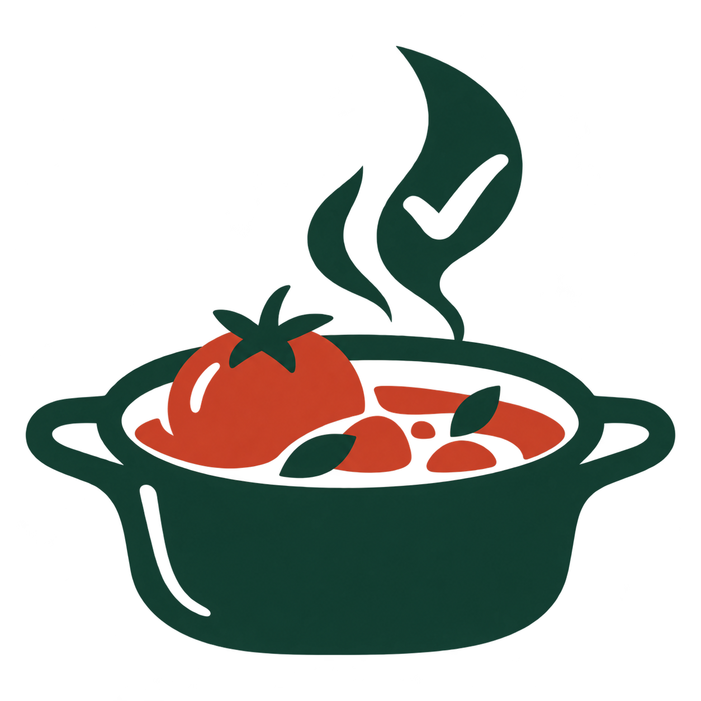

<p align="center">
  <a href="README.md">简体中文</a> · <strong>English</strong>
</p>

<p align="center">
  
</p>

<h1 align="center">Lean to Cook</h1>

<p align="center"><strong>Model cooking with mathematics. Turn intuition into clear standards.</strong></p>

<p align="center">
  <a href="https://github.com/forge-town/lean-to-cook/actions/workflows/ci.yml?query=branch%3Amain"></a>
  <a href="packages/lean-proofs/lean-toolchain"></a>
  <a href="LICENSE"></a>
</p>

<p align="center">
  <a href="#features">Features</a> ·
  <a href="#getting-started">Getting started</a> ·
  <a href="#technology">Technology</a> ·
  <a href="#acknowledgments">Acknowledgments</a> ·
  <a href="https://github.com/forge-town/lean-to-cook/issues">Report an issue</a>
</p>

---

Lean to Cook is an open-source project that combines interactive recipes, cooking animations and formal verification with Lean. Pick a recipe and follow each animated step, or open its Lean source to explore the conditions, quantities and state changes behind the process.

The project includes a recipe website, a separate content admin application and a Lean proof library for browsing recipes, exploring cooking steps, configuring ingredients and checking models.

## Features

| Module             | What you can do                                                                                                                                    |
| ------------------ | -------------------------------------------------------------------------------------------------------------------------------------------------- |
| Recipe library     | Browse recipes and photos by category, and view ingredients, quantities and complete instructions.                                                 |
| Cooking workbench  | Explore animated washing, cutting, heating, mixing and plating actions. Step through the process and revisit completed steps.                      |
| Lean proof library | Read models, specifications and proofs alongside cooking steps to inspect preconditions, execution order and final states.                         |
| Kitchen theories   | Explore formal descriptions of kitchen actions and quantity relationships, including what “as needed” means for ingredient quantities.             |
| Content admin      | Manage recipes, ingredients, categories and units; maintain ingredient images and recipe associations; inspect Lean source and validation results. |
| Component previews | View pages, animated scenes and ingredient components in Storybook, with links to their source files and Lean modules.                             |

## Local access

After starting the project locally, open:

| Entry point       | Address                                |
| ----------------- | -------------------------------------- |
| Home              | <http://localhost:7201>                |
| Recipe library    | <http://localhost:7201/source-recipes> |
| Cooking workbench | <http://localhost:7201/simulator>      |
| Proof library     | <http://localhost:7201/library>        |
| Kitchen theories  | <http://localhost:7201/theories>       |
| Content admin     | <http://localhost:7202>                |

## Getting started

Install Bun 1.3.11+, Docker and [Elan](https://github.com/leanprover/elan), the Lean toolchain manager. The proof package is pinned to Lean 4.25.0.

```bash
bun install
bun run db:setup
bun run db:migrate
bun run db:seed
bun run dev
```

`db:setup` creates a local PostgreSQL container and generates the environment configuration. The initial admin password is saved in the local `.env.local` file, which is excluded from Git.

Start component previews separately:

```bash
bun run storybook
# http://localhost:6006
```

## Technology

| Area                    | Technology                          | Source                                                                           |
| ----------------------- | ----------------------------------- | -------------------------------------------------------------------------------- |
| Recipe website          | React, TanStack Start, Tailwind CSS | [apps/web](apps/web)                                                             |
| Content admin           | React, TanStack Router, Refine      | [apps/admin](apps/admin)                                                         |
| API                     | Bun, tRPC                           | [apps/api](apps/api)                                                             |
| Data and business logic | PostgreSQL, Drizzle ORM             | [packages/db-schema](packages/db-schema), [packages/services](packages/services) |
| Recipe data models      | Zod                                 | [packages/schemas](packages/schemas)                                             |
| Formal verification     | Lean 4, Lake                        | [packages/lean-proofs](packages/lean-proofs)                                     |
| Recipes and photos      | A pinned HowToCook content snapshot | [content/how-to-cook](content/how-to-cook)                                       |

## Lean verification scope

| Model                    | What is checked                                                                                                                                     |
| ------------------------ | --------------------------------------------------------------------------------------------------------------------------------------------------- |
| Recipe structure         | Nonempty ingredient and step lists, step counts, consecutive indices and ordered execution within the model.                                        |
| Independent state models | Six recipes define their own action preconditions and state transitions, such as washing before cutting, plating the dish and turning off the heat. |
| Shared stage models      | Another fourteen recipes use shared stages, such as preparation, processing and completion, to check execution order.                               |
| Action mapping           | Checks that the frontend action list matches the order of the Lean model's plan.                                                                    |

Proof conclusions apply to the models defined in the code. Doneness, taste, nutrition and food safety require judgment during actual cooking. The animations themselves and full equivalence between TypeScript state execution and the Lean models are outside the scope of these proofs.

<details>
<summary>Development and validation commands</summary>

```bash
# Application checks
bun run test
bun run check-types
bun run lint
bun run build

# Compile Lean from the proof package directory
cd packages/lean-proofs
lake build
cd ../..

# Directory contracts, generated-file consistency and proof contracts
bun run check-anatomy
bun run generate-source-proofs --check
bun run generate-lean-metadata --check
bun run test:lean-architecture
bun run check-lean-contracts
bun run check-source-coverage
```

The Lean source is organized into shared core definitions, kitchen theories, recipe models, generated certificates and data contracts. Recipe units separate `Model.lean`, `Spec.lean` and `Proofs.lean`. Directory contracts are defined in [anatomy.json](anatomy.json).

After updating the recipe snapshot, run `bun run generate-source-proofs`. After changing models or frontend steps, run `bun run generate-lean-metadata`. Content saved through the admin application does not automatically modify recipe source files or Lean proof files.

</details>

## Contributing

Use [Issues](https://github.com/forge-town/lean-to-cook/issues) to report problems or suggest improvements to recipes and animations. Pull requests are welcome. When changing cooking actions or Lean models, also check the action mapping and related proofs using the development and validation commands above.

## Acknowledgments

Thank you to **[HowToCook](https://github.com/Anduin2017/HowToCook)** and all its contributors for collecting and sharing the recipes, quantities and photos that provide the content foundation for Lean to Cook.

This project includes a snapshot of HowToCook recipes and photos **as of October 26, 2026**, pinned to commit [`308cc8b7`](https://github.com/Anduin2017/HowToCook/commit/308cc8b7dab1da84b20e7fafdf836a715437f582). Later upstream changes are not included in this snapshot and are not synchronized automatically.

See [UPSTREAM.md](content/how-to-cook/UPSTREAM.md) for provenance. This content retains the upstream [Unlicense](content/how-to-cook/LICENSE).

## License

Original project code, Lean proofs and documentation are licensed under the **[Apache License 2.0](LICENSE)**. Third-party content and dependencies retain their respective licenses. See [NOTICE](NOTICE) for details.
